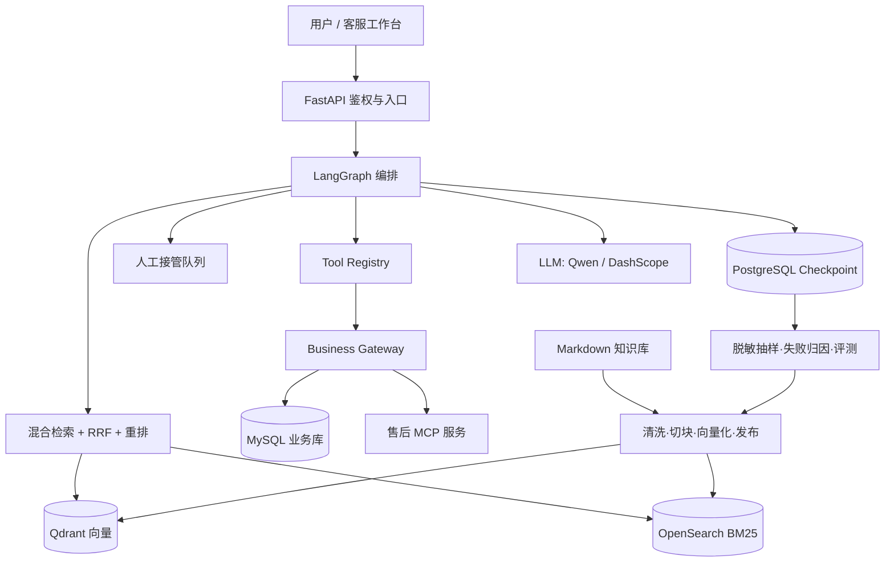

# ShopAssist — 电商客服 Agent

面向**中国消费电子品牌出海**（跨境电商）场景的 AI 客服 Agent：
品牌与供应链在国内，服务对象是美国和欧洲的终端消费者。
覆盖知识问答、订单与物流查询、海外仓退换货、售后工单创建、人工坐席接管和知识迭代闭环。

**语言与口径**：提供中文与英文两套租户。中文站面向国内团队演示，中文为默认；
英文站对应出海美国站，政策按目的国（30 天退货、18 个月保修、GDPR/CCPA、关税与进口清关）。
后台运营界面为中文，对应国内客服团队的实际工作方式。

模型负责**理解问题、有限规划、选择工具**；后端负责**业务事实、权限校验、风险控制、写操作审计**。
所有高风险写操作（退款、补发、换货）都必须经过人工确认、幂等保护和可恢复的审批流程。

> **定位与边界**
> 交互模式参考主流电商平台的客服中心：从"我的订单"进入、按订单发起咨询、
> 自助优先、解决不了转人工。本项目是独立实现，**不接入任何电商平台**，
> 不使用第三方商标、素材或内部系统命名；商品与订单数据均为自建演示数据。
>
> **跨境的真实约束**：库存分布在海外仓，缺货时从深圳直发（7-14 天，清关前轨迹不动）；
> 退货寄回目的国的区域退货中心，不是寄回国内；保修换新从区域仓发出，由本地服务伙伴承接。

---

## 1. 这个项目解决什么问题

电商客服的典型痛点不是"回答不上来"，而是：

| 痛点 | 本项目的处理方式 |
| --- | --- |
| 型号/渠道/地区不同，政策不同 | 知识按文档版本 + 适用范围 + 生效时间管理，检索阶段带元数据过滤 |
| 用户口语化、指代多轮 | 结构化槽位 + 指代改写，槽位带来源和确认状态 |
| 订单/物流是实时事实 | 知识库不存订单状态，一律走 Tool → Business Gateway |
| 售后写操作不能交给模型随便做 | 读写工具分级、Approval Token、确认摘要、幂等键 |
| 接口超时但外部实际成功 | 结果记为 unknown，走对账/人工，不盲目重做 |
| 需要转人工但上下文丢失 | 转接任务携带身份校验状态、已确认字段、证据和排障记录 |
| 答错了不知道错在哪层 | trace 落库：query、候选、各阶段分数、版本，可分层归因 |

---

## 2. 核心能力

**多轮与记忆**
- 短期上下文（最近 N 轮）+ 会话摘要 + 长期偏好记忆
- 指代消解和结构化槽位，用户改口时相关字段与检索结果失效重算

**RAG 检索**
- Markdown 知识库按结构切块，保留标题、型号、适用范围
- 三路并发召回 → RRF 融合 → 可选 Reranker 精排：
  - 向量（Qdrant）：处理同义表达
  - BM25（OpenSearch）：词项召回，允许部分命中
  - 关键词覆盖：要求查询词大部分出现在同一块，补精确度；带业务编码时额外做短语匹配
- 知识文档版本、生效时间、内容哈希、双索引生命周期（先建后切，可回滚）
- 查询扩展（可选）：检索前用模型把口语问法改写成文档用词，作为**额外召回路**叠加，
  不替换原查询——改写错了也不会把原本正确的结果挤掉
- 低质量检索判定：证据不足时澄清或转人工，而不是硬答

**意图识别**
- `IntentClassifier` 用特征打分而不是关键词命中：单号、本人指向、查询请求、状态词、
  政策词、业务域各自独立加权，动作词只用于解释、不参与打分
- 输出 `knowledge / tool / hybrid` 与置信度；低置信度由上层决定是否升级到模型分类
- 判定结果带 signals 与 reason，可在 trace 里解释"为什么走了这条路"

**Agent 编排**
- LangGraph 状态图：prepare → rewrite → retrieve → evaluate_retrieval → decide → 执行/澄清/转人工
- 有界规划（最大步数、最大 LLM 调用、最大工具调用），不让模型无限 ReAct
- Checkpoint 持久化到 PostgreSQL，支持中断、人工介入、服务重启后恢复

**工具与可靠性**
- Tool Registry：JSON Schema 校验、超时、风险等级、是否需确认
- Business Gateway：租户/用户/会话上下文由服务端注入，模型不能自报身份
- 幂等键 + 数据库唯一约束，防重复售后申请
- 外部 MCP 售后服务独立部署，服务间鉴权 + 调用签名 + Approval Token

**人工协同**
- 转人工建任务：排队 / 接单 / 处理 / 结论确认分别记录状态
- 坐席接手后机器人暂停业务动作；恢复时先核验状态与工具回执

**可观测与治理**
- Prometheus 指标、OpenTelemetry 链路、可选 LangSmith
- 租户级模型分档、检索策略、Token 预算与降级策略

---

## 3. 架构



**两个事实源**：产品与政策来自审核发布的知识库；订单、物流、售后状态来自业务系统。模型、缓存、向量库都不能覆盖它们。

---

## 4. 快速开始

### 4.1 前置

- Python 3.11+
- Docker Desktop

### 4.2 启动基础设施

```bash
docker compose --profile durable up -d mysql redis qdrant checkpoint-postgres
```

### 4.3 配置环境变量

复制 `.env.example` 为 `.env`，最少填写：

```dotenv
LLM_API_KEY=sk-xxx            # 阿里云百炼 DashScope
EMBEDDING_API_KEY=sk-xxx      # 可与 LLM 同一个 Key
LLM_MODEL=qwen3.8-flash
LLM_ENABLE_THINKING=false     # 关闭 Qwen3 思考，显著降低单轮耗时
```

Qwen3 系列默认会先输出思考内容。关闭后，同一套提示词下单轮响应从 30–80 秒降到 2–9 秒
（检索约 0.2–0.8 秒，其余是模型调用）。换用不支持 `enable_thinking` 的供应商时，把该行注释掉即可。

### 4.4 初始化数据库与样例数据

```bash
.venv/Scripts/python.exe -m alembic upgrade head      # Windows
# 或：.venv/bin/python -m alembic upgrade head         # macOS / Linux
```

```bash
.venv/Scripts/python.exe scripts/seed_sample_data.py
```

### 4.5 知识入库

```bash
.venv/Scripts/python.exe scripts/ingest_docs.py knowledge_base_us --tenant-id default
```

### 4.6 启动服务

```bash
.venv/Scripts/python.exe scripts/run_dev.py --host 127.0.0.1 --port 8000
```

- 运营验证台：<http://127.0.0.1:8000/>
- 接口文档：<http://127.0.0.1:8000/docs>
- 就绪检查：`GET /health/ready`

### 4.7 冒烟测试

```bash
# 1) 换一个演示令牌（身份不再由请求体自报）
TOKEN=$(curl -s http://127.0.0.1:8000/api/v1/auth/demo-token \
  -H "Content-Type: application/json" \
  -d '{"tenant_id":"default","user_id":"u001"}' | python -c "import sys,json;print(json.load(sys.stdin)['access_token'])")

# 2) 带令牌提问
curl -s http://127.0.0.1:8000/api/v1/chat \
  -H "Content-Type: application/json" \
  -H "Authorization: Bearer $TOKEN" \
  -d '{"tenant_id":"default","user_id":"u001","question":"Where is my order ORD-2026-100234?"}'
```

### 4.8 测试

```bash
.venv/Scripts/python.exe -m pytest -q
```

### 4.9 前端：C 端窗口 + 运营后台

```bash
npm --prefix web install
npm --prefix web run dev
```

两个界面，对应两种使用者：

| 路径 | 面向 | 内容 |
| --- | --- | --- |
| <http://127.0.0.1:5173/> | 客户 | 客服工作台：顶栏搜索与悬浮窗、二级导航、Agent 头部、锁定订单条、开场消息 + 订单选择卡、消息流、快捷胶囊、输入区 |
| <http://127.0.0.1:5173/admin> | 坐席 / 运营 | 待处理会话（10 秒轮询 + 角标通知）、调试对话、证据轨 |

右上角有**中英文切换**，中文是默认：

| 语言 | 租户 | 知识库 | 演示订单 | 用途 |
| --- | --- | --- | --- | --- |
| 中文 | `zh` | `knowledge_base/`（中国电商口径） | 3 个客户 × 3-4 单，如智能耳机 ¥299 · 顺丰 | 给中文面试官看，走查流程最快 |
| English | `us` | `knowledge_base_us/`（美国站 + 跨境） | 3 个客户 × 3 单，如 Wireless Earbuds Pro $79.99 · UPS | 出海场景 |

订单覆盖待发货、已发货、已签收、已退款、已取消，每个客户只能看到自己的订单，
方便演示物流查询、退换货、价保和越权拦截。

语言切换同时切换租户、语料和订单，两套数据不会混在一起。

身份由令牌携带，不在前端自报。切右上角"演示账号"可以体验权限差异：

| 账号 | 角色 | 能做什么 |
| --- | --- | --- |
| u001 | customer | 只能访问自己的订单 |
| u002 | customer | 另一个客户，访问不到 u001 的订单 |
| u003 | agent | 可以查看待处理会话与证据轨 |
| u004 | operator | 确认坐席提交的处理结果，完成转人工闭环 |
| u005 | customer | 第三个客户，用于演示多客户订单与隔离 |

演示账号白名单来自 `DEMO_LOGIN_USERS`。生产环境应接企业 SSO：
`/api/v1/auth/demo-token` 只解决"本地演示怎么拿到可信凭证"，不是认证系统。

后台的"待处理会话"每 10 秒轮询一次，新到会话高亮并挂角标；点击一条会话即可在右侧面板
接入、回复、提交处理结果，运营账号确认后回到 Bot 或结束会话。生产应换成服务端推送。

生产构建：

```bash
npm --prefix web run build
```

---

## 5. 目录结构

```text
├── src/customer_service_app/
│   ├── api/                 # HTTP 路由（chat / conversation / confirmation / handoff / memory / ops）
│   ├── core/                # 配置、鉴权、异常、中间件、日志
│   ├── domain/              # 领域模型与状态定义
│   ├── infrastructure/      # DB、缓存、向量库、BM25、关键词覆盖、LLM、Embedding、Rerank、MCP 适配器
│   ├── services/            # 会话、记忆、规划、RAG、确认、人工、成本治理
│   ├── tools/               # Agent 工具（订单、物流、退款、补发、换货、知识检索）
│   ├── workflows/           # LangGraph 状态图、节点、运行时
│   └── web/                 # 运营验证台
├── mcp_services/after_sales_server/   # 独立售后 MCP 服务
├── knowledge_base_us/       # 当前生效的英文知识库（美国站口径，跨境场景）
├── knowledge_base/          # 中文语料（历史基线，保留用于对照）
├── eval/                    # 分层评测集：seeds_us.json 为当前英文基线，seeds*.json 为历史中文基线
├── migrations/              # Alembic 迁移
├── scripts/                 # 启动、入库、评测、种子数据
├── tests/                   # 单元与集成测试
├── web/                     # React + TypeScript 客服工作台（Vite）
└── deploy/                  # Prometheus / Grafana / OTel 配置
```

---

## 6. 与上游项目的关系

本项目以 [iwcdoit/enterprise-customer-service-agent-v2](https://github.com/iwcdoit/enterprise-customer-service-agent-v2)（MIT）为代码底座进行二次开发。
保留其分层结构、LangGraph 编排骨架、工具治理模型和测试体系；改造内容见下一节。

面试时应当如实说明"基于开源架构二次开发"，并把能讲清的模块对应到自己实际改动过的代码上。

---

## 7. 本次改造清单

| 改动 | 文件 | 原因 |
| --- | --- | --- |
| 新增阿里云百炼 gte-rerank 适配器 | `infrastructure/rerank/dashscope_reranker.py` | 上游只支持 BGE/Cohere 风格接口，百炼的 body 与返回结构不同 |
| Rerank provider 可配置 | `core/config.py`、`infrastructure/rerank/factory.py` | 支持 `RERANK_PROVIDER=dashscope` |
| 修复 Windows 事件循环冲突 | `scripts/run_dev.py`、`customer_service_app/__init__.py` | uvicorn 0.36+ 在 Windows 强制 ProactorEventLoop，psycopg 异步连接失败 |
| 复用 `DASHSCOPE_API_KEY` | `core/config.py` | LLM / Embedding / Rerank 共用一套凭证，避免把密钥写进 .env；只在 `get_settings()` 生效，不污染单元测试 |
| 修复"还能"被误判为指代 | `services/question_rewrite_service.py` | "耳机还能退吗"这类正常问法被拦成"指代不清"，命中率崩掉 |
| 修复待确认动作的 `MissingGreenlet` | `infrastructure/db/repositories.py` | `created_at` 是 server_default，flush 后访问会触发同步懒加载，导致退款确认链路 500 |
| 新增端到端冒烟脚本 | `scripts/smoke_scenarios.py` | 5 个场景覆盖知识问答、订单查询、越权、多轮退款确认、超纲拒答 |
| 新增输出校验，拦截"未执行却宣称完成" | `services/answer_guard.py`、`workflows/nodes.py` | 实测出现过模型编造工单号（`RS202611080001`）而后台根本没有记录 |
| 修复"问流程"被误判成"查实时数据" | `services/question_router.py` | 动作词（申请/创建/提交）被当成执行请求，检索被短路；改为只有具体单号、本人数据或明确查询请求才走实时工具 |
| 修复文档类型白名单漏项 | `services/question_router.py` | 召回阶段按关键词推断文档类型，正确文档被静默过滤；改为只保留租户/权限等可信范围，类型交给排序 |
| 修复过期语料与评测集不一致 | `knowledge_base/announcements/*` | 两篇公告 `expires_at` 早于评测日期，被生命周期正确排除却仍在评测集里 |
| 新增 React + TS 客服工作台 | `web/` | 原项目只有单页 HTML 验证台，无法展示引用、回执与审批的完整关系 |
| 修复审批链路的 naive/aware 时间比较 | `services/confirmation_service.py`、`infrastructure/db/repositories.py` | MySQL `DATETIME` 丢时区，比较直接抛 `TypeError`，审批接口 500 |
| 修复 MySQL 与应用时区不一致 | `docker-compose.yml` | `created_at` 由服务器 `now()` 生成是本地时间，应用写的是 UTC，等待时长算成负数 |
| 补齐计划分支的审批回执 | `workflows/nodes.py` | 计划流程审批后不写 `tool_results`，前端拿不到执行回执 |
| 新增分层评测集与执行器 | `eval/`、`scripts/build_eval_set.py`、`scripts/evaluate_eval_set.py` | 原项目只有 20 条检索样例，无法按类别、风险、切分归因 |
| 意图识别改为特征打分分类器 | `services/intent_classifier.py`、`services/question_router.py` | 关键词规则会让动作词、"本人"等弱信号互相放大，盲测暴露了泛化缺口 |
| 问题改写改为渐进式 | `services/question_rewrite_service.py`、`workflows/nodes.py` | 原来短问题一律调用改写模型，每个问题多 1–3 秒；现在自带单号/业务词/无上下文直接走规则，只有指代和省略追问才用模型，检索不足时再升级一次 |
| 新增关键词覆盖召回通道 | `infrastructure/keyword_search/`、`services/rag_service.py` | 三路召回（向量 / BM25 / 关键词覆盖）用 RRF 融合，补精确度 |
| 新增查询扩展召回路 | `services/query_expansion_service.py`、`services/rag_service.py` | 盲测失败集中在"措辞不同导致词锚断裂"，检索前用模型把口语改写成文档用词，作为额外召回路而不替换原查询 |
| 鉴权默认开启 | `api/routes_auth.py`、`core/security.py`、`web/src/api.ts` | 原来 `SECURITY_ENABLED=false`，请求体里的 user_id 就是身份；改为令牌携带身份，客户只能访问自己的资源 |
| 回答格式与语气约束 | `prompts/customer_service.py`、`services/answer_guard.py` | 原提示词只管内容不管格式，输出充满 emoji 和加粗小标题；现在约束结构并用 `strip_decorations()` 兜底清理 |
| C 端与后台拆分 | `web/src/components/CustomerChat.tsx`、`AdminConsole.tsx` | 原来一个页面把引用打分、工具回执、执行轨迹都给了 C 端；现在 `/` 只聊天，`/admin` 才是坐席后台 |
| 新增订单入口接口 | `api/routes_orders.py`、`infrastructure/db/repositories.py` | 参考主流电商的客服入口，C 端先看到自己的订单再按订单咨询；订单归属取自令牌主体 |
| 会话恢复（persistent chat） | `api/routes_conversations.py`、`services/conversation_service.py`、`migrations/0010` | 参考主流云客服的 persistent chat：重进页面接回上次会话与线程，24 小时窗口内有效，结束会话后不再恢复 |
| 转人工改为确定性执行 | `services/intent_classifier.py`、`workflows/nodes.py`、`tools/handoff_tools.py` | 用户明确要求人工时模型未必调用工具，还会编造"已转接"；现在由编排层直接执行 |
| 售后凭证图片上传 | `api/routes_uploads.py`、`migrations/0011`、`web/src/components/CustomerChat.tsx` | 图片按租户/用户落盘，读取按归属校验；聊天前复核附件归属，防止把他人凭证挂到自己消息上 |
| 会话满意度评价（CSAT） | `api/routes_conversations.py`、`api/routes_csat.py`、`services/csat_service.py`、`migrations/0012`、`web/src/components/CsatPanel.tsx` | 结束会话后客户评 1-5 星、标签和评论；一条会话一条评价，重复提交覆盖；客户看不了全租户汇总 |
| C 端会话状态机 | `api/routes_conversations.py`、`services/human_support_service.py`、`web/src/components/CustomerChat.tsx` | 客户每 4 秒看到排队位置、坐席接入、处理结果和结束状态；人工消息轮询补入；排队中结束会话会取消转人工 |
| 后台人工处理面板 | `web/src/components/HandoffWorkbench.tsx`、`web/src/components/HandoffQueue.tsx`、`api/routes_human_support.py` | 坐席在 `/admin` 内完成接入、回复、提交结果，运营确认后回到 Bot 或结束会话；队列默认只显示处理中的任务 |
| 修复数据库时间序列化时区 | `core/time_utils.py`、`api/routes_conversations.py` | MySQL `DATETIME` 无时区，naive 时间直接序列化会被前端当成本地时间，恢复会话差 8 小时 |
| C 端隐藏内部执行信息 | `web/src/useChatSession.ts`、`api/routes_confirmations.py`、`workflows/nodes.py` | 客户侧曾出现"工具回执""线程已恢复"；现在只有后台展示工具与回执，确认完成后返回一句客户能看懂的结果 |
| 客服话术改为真人风格 | `prompts/customer_service.py` | 按"接话—进度—单步确认"三段式组织回复，禁止 Markdown、编号列表和 AI 套话；确认提示跟随租户语言 |

---

## 8. 评测

### 8.1 快速消融（20 条）

固定评测集：`knowledge_base/evaluation_queries.json`（20 条，含 exact / semantic 两类）。

```bash
# 基线：纯向量
OPENSEARCH_ENABLED=false RERANK_ENABLED=false \
  .venv/Scripts/python.exe scripts/evaluate_retrieval.py --queries knowledge_base/evaluation_queries.json

# 向量 + 重排
OPENSEARCH_ENABLED=false RERANK_ENABLED=true \
  .venv/Scripts/python.exe scripts/evaluate_retrieval.py --queries knowledge_base/evaluation_queries.json --rerank
```

实测结果（20 条自建评测集，仅代表本语料，不能当线上效果）：

| 配置 | Hit@5 | MRR |
| --- | --- | --- |
| 纯向量（修复前） | 0.65 | 0.60 |
| 纯向量（修复三项缺陷后） | 1.00 | 0.95 |
| 混合召回（dense + BM25 + RRF） | 1.00 | 0.95 |
| 混合召回 + 百炼重排 | 1.00 | 1.00 |

完整记录、失败归因和复现命令见 [evidence/retrieval_ablation.md](evidence/retrieval_ablation.md)。

### 8.2 分层评测集（600 条）

20 条样本只能看趋势，不能按类别归因。`eval/` 下是一个分层评测集：

- **60 条独立语义种子**（`eval/seeds.json`，人工编写，每条都能对到具体文档与具体事实）
- **每条扩展 10 种表达**（原句 + 口语化 / 简短 / 礼貌 / 背景 / 同义 / 中英混 / 情绪 / 书面 / 赘词），
  合计 600 条；改写只改表达，订单号与规则编号必须原样保留（`tests/test_eval_set.py` 会校验）
- **按种子分组切分**：300 开发 / 300 封闭测试，同一 seed 的变体不会跨侧，改写不会泄漏到测试集
- 类别覆盖：政策、排障、物流、售后、风控、企业 SLA、实时工具、超纲、对抗

```bash
# 用模型生成表达变体（失败时自动回落到确定性模板）
.venv/Scripts/python.exe scripts/build_eval_set.py

# 跑检索 + 路由评测，输出 Markdown 报告
.venv/Scripts/python.exe scripts/evaluate_eval_set.py
```

当前英文语料的基线见 [evidence/eval_report_us.md](evidence/eval_report_us.md)（Hit@5 0.964 / MRR 0.909 / 路由 0.968）；
中文语料时期的结果见 [evidence/eval_report.md](evidence/eval_report.md)；
这批评测集实际暴露的三类缺陷与修复过程见 [evidence/eval_findings.md](evidence/eval_findings.md)。

首轮到最终：Hit@5 **0.882 → 0.996**，MRR **0.838 → 0.925**，路由准确率 **0.900 → 0.996**。
开发集 0.992 / 封闭测试集 1.000；剩下 2 条失败都是中英混写丢了中文关键词锚点。

但这批数字是在**用来发现并修复缺陷的同一批数据**上取得的，不是盲测。所以另建了一套
45 条全新种子（`eval/seeds_blind.json`，与第一套问题零重叠）做盲测：

| 指标 | 调参集 | 盲测 v1 | 盲测 v2 | 盲测 v3（干净） |
| --- | ---: | ---: | ---: | ---: |
| 检索 Hit@5 | 0.994 | 0.987 | 0.956 | 0.979 |
| 检索 MRR | 0.926 | 0.920 | 0.889 | 0.923 |
| 路由准确率 | 0.995 | 1.000 | 0.995 | 0.997 |

前三套都已用于诊断，只有 v3 是跑之前没读过的干净数字。
**结论要克制**：改造前在 v1 上第一次跑出的干净数字是 0.984 / 0.909 / 0.988，
改造后在一套全新种子上是 0.979 / 0.923 / 0.997——Hit@5 的差异小于集合之间的难度波动，
不能当成提升。真正能确认的改进是路由（0.988 → 0.997）和决策可解释性。
细节见 [evidence/blind_test_v3.md](evidence/blind_test_v3.md)。

针对"表达重叠度低"这个瓶颈还试过**查询扩展**（检索前把口语改写成文档用词，作为额外召回路）。
结论是负面的：同一套 v3 上 Hit@5 从 0.979 掉到 0.967，代码保留但默认关闭。
记录见 [evidence/query_expansion.md](evidence/query_expansion.md)。

掉了大约 1 个百分点，说明前面的修复多数在修机制，但关键词路由仍有泛化缺口。
失败归因和"为什么我没有在盲测集上继续改"见 [evidence/blind_test.md](evidence/blind_test.md)。

针对这些缺口，又做了一轮机制改造：意图识别换成特征打分分类器、检索加第三路关键词覆盖通道。
改造过程与三轮评测数字见 [evidence/mechanism_v2.md](evidence/mechanism_v2.md)。

> 口径说明：600 条由 60 条独立语义扩展而来，**真正独立的语义只有 60 条**。
> 变体衡量的是表达鲁棒性，不是知识覆盖度；要衡量覆盖度需要先扩大语料。

---

## 9. 面试可举证清单

| 能讲清的结论 | 需要的证据 |
| --- | --- |
| 检索链路有效 | `scripts/evaluate_retrieval.py` 在固定评测集上的 Hit@K / MRR |
| 评测集没有被改写泄漏污染 | `eval/eval_set_v1.json` 的 `split` 字段 + `tests/test_eval_set.py` 的分组校验 |
| 重排有增益 | 同集合同预算下 dense / hybrid / hybrid+rerank 的消融对比 |
| 幂等真的生效 | `tests/test_confirmations_and_mcp.py` + 并发重复提交的故障注入记录 |
| 超时不等于失败 | unknown 状态分支与对账逻辑的测试用例 |
| 恢复不重复副作用 | Checkpoint + 业务操作表的恢复用例 |
| 权限边界 | 模型伪造 user_id / 越权订单号的拒绝用例 |
| 审批后确实执行了业务写入 | `pending_actions.status=executed` + `support_tickets` 新增记录 + 工作台回执截图 |
| 时间语义一致 | 审批等待时长为正数；`SELECT NOW()` 与应用 UTC 时间一致 |

---

## License

MIT
